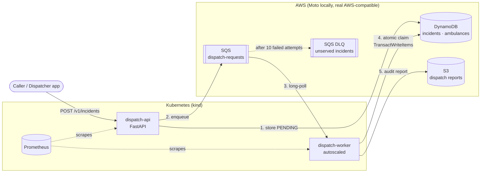
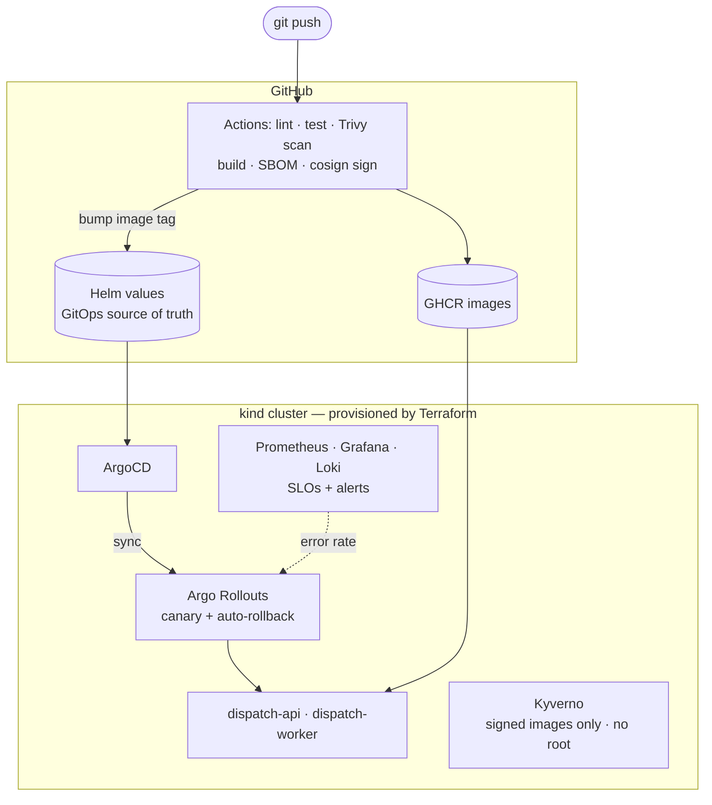

# RescueOps — Emergency Ambulance Dispatch Platform

> A production-style DevOps platform for routing emergency calls to the nearest available ambulance in Lagos.
> Runs **100% locally, with no cloud bill**: Kubernetes on [kind](https://kind.sigs.k8s.io/), AWS services emulated by [Moto](https://github.com/getmoto/moto), and everything provisioned with Terraform.

Inspired by field work for an "Uber for ambulances" startup in Lagos, where every minute of dispatch delay matters.

## Architecture



### Dispatch flow

1. **dispatch-api** validates the emergency call, stores it as `PENDING` in DynamoDB and returns `202 Accepted` immediately, so a caller is never left waiting on matching logic.
2. The request goes onto an **SQS** queue. Traffic spikes, like a multi-vehicle accident, queue up instead of overloading the system.
3. **dispatch-worker** ranks available ambulances by distance (haversine formula) and claims the nearest one with a single **DynamoDB transaction**. The ambulance moves `AVAILABLE → DISPATCHED` and the incident moves `PENDING → DISPATCHED`, or nothing changes. Two workers can never send the same ambulance to two incidents.
4. Redelivered messages are detected and ignored (**idempotency**). If no ambulance is free, the request is retried every 15s. After 10 attempts it moves to a **dead-letter queue**, which triggers an alert.
5. A JSON dispatch report goes to **S3** as an audit trail.

### Platform architecture (target state)



## Roadmap

| Phase | Scope | Status |
|---|---|---|
| 1 | Services, tests, hardened Dockerfiles, docker-compose with Moto | ✅ |
| 2 | Terraform: kind cluster + DynamoDB/SQS/S3 via the AWS provider | ⏳ |
| 3 | CI: GitHub Actions, Trivy, SBOM, cosign signing, GHCR | ⏳ |
| 4 | CD: Helm charts, ArgoCD app-of-apps, Argo Rollouts canary | ⏳ |
| 5 | Observability: Prometheus, Grafana, Loki, SLO burn-rate alerts | ⏳ |
| 6 | Security & resilience: Kyverno, NetworkPolicies, k6 load tests, chaos | ⏳ |

## Quick start

Requirements: Docker and `make`. Nothing else, and no cloud account.

```bash
make up      # build + start Moto, bootstrap AWS resources, start services
make seed    # register 5 ambulances across Lagos
make demo    # report an emergency at Ojuelegba and watch it get dispatched
make test    # lint + unit/integration tests inside Docker
make down    # tear everything down
```

Example output:

```
incident reported: 7b1e...
dispatched LAG-AMB-002: 0.87 km away, ETA 1.3 min
```

Interactive API docs: http://localhost:8080/docs · API metrics: http://localhost:8080/metrics · worker metrics: http://localhost:9100/metrics

## Engineering decisions

| Concern | Decision |
|---|---|
| Cost | Moto emulates AWS; Terraform uses the real `aws` provider, so the same code targets real AWS by removing the endpoint overrides ([ADR-0001](docs/adr/0001-local-aws-emulation-with-moto.md)) |
| Reliability | Async queue, idempotent consumer, atomic transactional claims, DLQ ([ADR-0002](docs/adr/0002-async-dispatch-with-sqs-and-transactions.md)) |
| Container security | Multi-stage builds, non-root UID 10001, read-only root filesystem, pinned dependencies |
| Testing | Tests run against Moto's in-memory AWS, so they exercise real boto3 calls with no mocks to drift; they run in a Docker build stage, identical locally and in CI |
| Observability | JSON structured logs, Prometheus RED metrics with bounded label cardinality, business metric `rescueops_time_to_dispatch_seconds`, worker heartbeat gauge |
| Privacy | Caller phone numbers are stored but never logged or put on the queue |
| Operability | `/healthz` (liveness) vs `/readyz` (checks DynamoDB + SQS), graceful SIGTERM shutdown |

## Repository layout

```
services/
  dispatch-api/       FastAPI service: incidents + ambulance fleet
  dispatch-worker/    SQS consumer: matching + atomic dispatch
scripts/              AWS bootstrap, seed data, demo
docs/adr/             Architecture decision records
docker-compose.yml    Local stack with Moto
```
